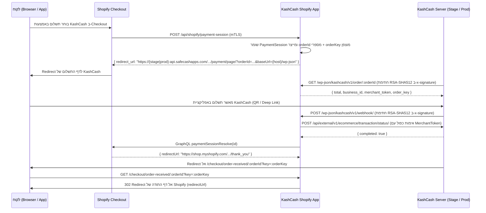

# KashCash Payments App for Shopify (`shopify-kashcash-payments`)

תוסף סליקה רשמי לשופיפיי (**Shopify Offsite Payments App**) עבור **KashCash**, התומך בשתי הסביבות (**DEV/STAGE** ו-**PROD**) ועובד מול ה-Ecommerce API של `cashi-server` באותו פרוטוקול ואבטחה כמו תוסף ה-WooCommerce הקיים.

---

## ארכיטקטורה וזרימת התשלום (End-to-End Flow)



---

## אבטחה (Security Highlights)

1. **אימות חתימות RSA-SHA512 מול KashCash (`x-signature`)**:
   - אימות קריפטוגרפי מלא (`RSA-SHA512`) על `Method`, `PathAndQuery` ו-`Body` מול המפתח הציבורי של `ECommerceBackChannel` ב-`cashi-server`.
2. **אימות כפול של סטטוס עסקה (Double Verification)**:
   - בעת קבלת Webhook של `approved`, השרת לא מסתפק ב-Webhook אלא מבצע קריאת אימות אקטיבית אל `POST /api/external/v1/ecommerce/transaction/status/` עם ה-`MerchantToken` של הסוחר ומוודא ש-`completed === true`.
3. **הצפנת טוקנים במנוחה (AES-256-GCM)**:
   - גם ה-`MerchantToken` של KashCash וגם ה-`access_token` של Shopify נשמרים במסד הנתונים כשהם מוצפנים ב-`AES-256-GCM` עם IV אקראי ו-AuthTag של 16 בתים.
4. **אימות Shopify HMAC-SHA256 ו-mTLS**:
   - כל תהליך ה-OAuth וה-Webhooks של Shopify (כולל GDPR: `shop/redact`, `customers/redact`, `customers/data_request`, `app/uninstalled`) מאומתים באמצעות `crypto.timingSafeEqual`.
   - תמיכה ב-mTLS (`MTLS_REQUIRED=true`) מול קריאות ה-Session של Shopify.
5. **הגנת SSRF ו-HTTP Security Headers**:
   - אימות קפדני של `*.myshopify.com`, כותרות `Helmet` (CSP, HSTS), ולוגים מובנים (`pino`) המצנזרים אוטומטית טוקנים וסודות.

---

## סביבות עבודה: DEV (Stage) ו-PROD

| סביבה | קובץ הגדרות Shopify CLI | קובץ סביבה | שרת KashCash יעד |
|---|---|---|---|
| **DEV / STAGE** | `shopify.app.dev.toml` | `.env.development` | `https://stage-api.safecashapps.com` |
| **PRODUCTION** | `shopify.app.prod.toml` | `.env.production` | `https://prod-api.safecashapps.com` |

> **הערה:** גם בסביבת PROD, אם עסקה מסומנת כ-`test: true` בשופיפיי או שהסוחר הפעיל **Test Mode** במסך ההגדרות של התוסף, העסקה תופנה אוטומטית ל-`stage-api.safecashapps.com`.

---

## התקנה והרצה

```bash
# התקנת תלויות
npm install

# הרצת בדיקות (Unit + Integration)
npm test

# בדיקת קומפילציית TypeScript
npm run lint

# הרצה מקומית במצב פיתוח
npm run dev

# פריסת ה-Extension לשופיפיי (DEV או PROD)
npm run shopify:deploy:dev
npm run shopify:deploy:prod
```
